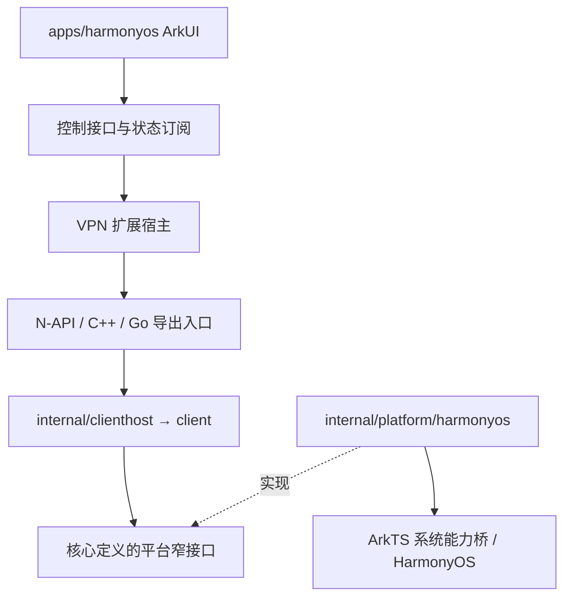

# 项目布局

状态：稳定归属规则；各客户端源码已迁入目标目录，目标平台验收分别记录。更新：2026-10-29。

本文定义源码归属、依赖边界和迁移门槛，不表示全部平台已完成运行与发布验收。
运行模型见[技术架构](architecture.md)，操作入口见[开发与发布](development.md)，
功能及发布验收结论见[验证记录](validation.md)；本文不维护第二套构建操作手册。

## 1. 背景与目标

共享业务在 internal/client、clienthost、server、privileged 中已有清晰职责。
原有 platform/、ui/、mobile/、ios/ 与客户端 packaging/ 已按归属迁入 apps/：
各平台原生工程在 apps/<platform>，Fyne/Wails 工程在 apps/shared/<技术栈>，
跨平台品牌资源在 assets/branding。fnOS 服务端交付工程仍在 packaging/fnos。

目标是让平台应用源码、宿主、桥接、资源和工程配置有统一入口，并明确它们与共享业务、
系统适配、自动化及交付配置的边界。新增 apps/ 表达平台应用工程；不以目录名称推断
现有目录的历史设计意图。

## 2. 顶层目录职责

| 目录 | 职责 | 边界 |
| --- | --- | --- |
| cmd/ | Go CLI、daemon 可执行入口 | 命令解析和组装，不承载 UI |
| internal/ | 共享业务、契约、宿主、特权操作及 Go 系统适配 | 不依赖平台 UI 工程或 N-API |
| apps/<platform>/ | 平台应用工程：UI、生命周期、桥接、组装、资源、原生工程配置 | 不复制共享认证、选路、重连状态机 |
| apps/shared/ | 按技术栈组织的跨平台应用工程，如 fyne/、wails/ | 可含薄宿主和桥接；不复制核心业务，不设泛化 common/utils |
| assets/branding/ | 跨平台品牌源文件的目标归属 | 平台尺寸变体与厂商必需资源可留在工程内，注明生成关系 |
| localization/ | 跨平台消息权威来源 | 不强制合并平台独有消息；生成资源标明来源 |
| scripts/ | 统一操作入口与分平台自动化实现 | 不隐藏正式应用源码或维护第二份 manifest |
| docs/ | 产品、架构、协议、版本及验证契约 | 平台操作并入现有开发文档 |
| .dev/<platform>/ | 本机配置、缓存、生成物、开发构建和诊断报告 | 忽略提交，可删除后由源码与工具链恢复 |
| dist/<platform>/ | 面向交付的安装包、符号及构建清单 | 忽略提交，与开发中间文件分开 |

platform 名称固定为 macos、windows、linux、android、ios、harmonyos。
iPadOS 属于 ios，不单独复制工程。internal/platform/darwin 等现有 Go 包名不为统一外观强行改名。

### platform 与 packaging 的去向

原顶层 platform/ 的原生客户端 UI 已移入 apps/<platform>/；
Go 系统实现继续留在 internal/platform/，两者不会合并。

客户端交付专用配置归属 apps/<platform>/packaging/。
必须由原生工程识别的 manifest、Info.plist、entitlements、资源及构建描述文件，
保留在原生工程要求的位置，不在 packaging/ 复制一份。

packaging/fnos 保留为服务端交付工程，本提案不强行把无独立客户端 UI 的服务端归入 apps/。
共享品牌源文件及既有派生图标已迁入 assets/branding，消费脚本与生成链使用同一来源。
厂商工程内的资源继续由各自工程维护；不保留旧路径副本。packaging/ 仍保留现有交付回归测试，
其中版本、本地化检查跨平台运行；平台测试的包归属可单独整理，不影响源码入口。
迁移期间允许旧目录存在，但每项源码或配置只能有一个权威来源。

### 平台入口与共享工程

apps/<platform> 是平台工程入口，不要求包含该平台消费的全部源码。
Android/iOS 可共用 apps/shared/fyne，macOS/Linux 可共用 apps/shared/wails。
共享工程允许保留框架所需的薄宿主、平台选择文件和桥接，不为“纯呈现”强行拆包；
认证、选路、重连状态机仍归共享核心。没有实际消费者时不提前创建目录。

Windows 当前归属：apps/windows 包含 CMake、原生 UI、manifest、版本资源模板与本地化；
apps/windows/packaging 包含 MSI 语言资源。自动化仍在 scripts/ 与 scripts/windows，
Go 系统实现仍在 internal/platform/windows。共享图标引用 assets/branding 的唯一来源。
现有 .dev/windows-* 与 dist/windows-native 路径暂保留，后续独立调整产物布局，避免改变消费方。

## 3. 鸿蒙目标结构

```text
apps/harmonyos/
├── toolchains.json                   唯一固定工具链清单
├── AppScope/                         应用元数据与公共资源
├── entry/
│   ├── build-profile.json5
│   ├── oh-package.json5
│   ├── hvigorfile.ts
│   └── src/main/
│       ├── module.json5
│       ├── ets/
│       │   ├── entryability/         UI 应用生命周期
│       │   ├── vpnability/           VPN 扩展生命周期与系统入口
│       │   ├── pages/
│       │   ├── components/
│       │   ├── controller/           命令、状态订阅与展示模型
│       │   └── platform/             ArkTS 系统 API 适配
│       ├── cpp/                      N-API、线程派发与 ABI 桥
│       └── resources/
├── go/                               Go 导出入口及宿主组装
├── diagnostics/                      runtime/VPN 专项验证源码
├── tests/                            平台集成、宿主与 UI 验证
├── packaging/                        分发配置、签名模板、许可清单
├── hvigor/
├── build-profile.json5
├── oh-package.json5
└── hvigorfile.ts

internal/platform/harmonyos/           Go TUN/WireGuard、网络与系统适配
scripts/harmonyos/                     安装、构建、签名、检查实现
.dev/harmonyos/                        本机状态、开发产物与验证报告
dist/harmonyos/                        发布候选产物
```

这是归属规范，不要求一次创建所有空目录。VPN 扩展先留在 entry 模块；是否拆成其他
HAP/HSP 模块由平台约束和部署需求决定，目录设计不预设进程数量或安装包数量。
诊断程序与正式应用分开选择构建目标，不能把测试回显器、测试路由或自动请求公网的行为
带入正式用户流程；诊断权限和测试端点仅在诊断目标声明。

正式原生工程直接纳入版本管理。生成脚本可继续产生桥接头文件、版本资源和中间工程，
但不把整个正式工程的唯一来源隐藏在 Python 字符串中。
若厂商工具必须在工程内写入 build/、.hvigor/、oh_modules/ 等内容，按明确规则忽略，
无须为追求目录外观改写厂商布局。生成的 Go .so/.h 同样忽略，不提交二进制副本。
依赖锁文件按对应构建工具规则提交，保持依赖版本可追溯。

## 4. 依赖与组件关系



- apps/harmonyos/go 可以导入 internal/clienthost、client 和平台适配，负责组装。
- internal 不导入 apps，UI/桥接依赖不能泄漏到共享业务。
- 平台适配通过接口或回调使用宿主能力，不反向导入应用入口。
- N-API 管理 ABI、线程、资源所有权和异步事件，不持有第二套产品状态机。
- 桌面继续保持 client daemon 与 client privileged daemon 的权限隔离。
- 移动端复用同一业务与网络计划边界，不照搬桌面双 daemon 进程；唯一活动 Manager
  由系统生命周期宿主持有。组件通信方式与授权边界不因目录移动而变化。

鸿蒙 go/ 初期使用根 Go module，避免仅为目录组织引入新 module 或不必要依赖。
Fyne/Wails 保留现有独立 module 边界，物理路径迁移后再单独评估模块调整；
不将 module 重构、UI 框架替换和目录搬迁混入同一变更。

### 平台适配判定与 Go module 约束

| 代码性质 | 归属 |
| --- | --- |
| 实现核心窄接口、无需 UI 框架的 Go 网络/系统适配 | internal/platform/<platform> |
| JNI、C ABI、N-API、UIKit/Fyne 绑定及线程派发 | 对应平台或共享应用工程 |
| 生命周期、活动 Manager 所有权与宿主组装 | 应用宿主 |
| 多端共用的产品业务 | 现有共享核心中的对应包 |

不按“系统相关”或旧目录名称机械迁入 internal/platform。平台适配可以通过注入的接口
使用原生能力，但不能反向依赖应用包或带入 UI 框架依赖。

保留根、mobile、ui 三个现有 module path 的职责边界；当前物理位置分别为根、
apps/shared/fyne、apps/shared/wails。目录迁移不自动要求更改 module path 或增加 module。
实施前逐项确认 module path、包导入路径、Go internal 可见范围、replace 相对路径、
构建 cwd、build tags 与资源嵌入路径，并覆盖独立 module 的检查入口。
iOS 扩展 Go 入口已迁入 apps/ios/go 并由根 module 编译；Go VPN 适配在
internal/platform/ios，App/扩展共用的日志桥协议在 apps/ios/bridge/logs。
Android Go VPN 适配在 internal/platform/android。依赖 Fyne 的 JNI/UIKit 宿主仍在共享
Fyne module；它们通过根 module 使用上述适配，不再依赖旧 mobile/internal VPN 包。

## 5. 自动化和工具链约定

scripts/ 根目录提供少量固定操作入口，分平台辅助实现归 scripts/<platform>/。
现有 Windows setup/build/check 入口保持不变；鸿蒙入口如下：

| 入口 | 职责 |
| --- | --- |
| scripts/setup-harmonyos-macos.sh | 显式准备固定 CLI/Go，复用公共安装并运行构建探针 |
| scripts/build-harmonyos.sh | 使用已有工具链构建；不隐式安装工具或接受许可 |
| scripts/check-harmonyos.sh | 静态检查、单元测试、包内容检查；设备检查显式选择目标 |
| scripts/package-harmonyos.sh | 使用显式签名配置生成可交付产物和清单 |

诊断构建作为明确目标或参数接入，不持续增加同义顶层入口。实际参数统一见开发文档。
尚未实现的入口在文档中标记为计划，不写成可直接执行的现有命令。

工具链仅在 apps/harmonyos/toolchains.json 维护，脚本读取该清单；
公共依赖目录沿用 ~/.local/opt/harmonyos/ 与 ~/.cache/harmonyos/，不含项目名称，
不覆盖默认主机 Go，不全局设置交叉编译变量。
证书、私钥、profile、密码及 token 放在仓库外，通过显式参数或环境注入；
项目内只提交无敏感信息的模板。

## 6. 当前状态与目标映射

| 范围 | 当前状态 | 目标或后续处理 |
| --- | --- | --- |
| HarmonyOS | apps/harmonyos 与 internal/platform/harmonyos 已落地 | 保持边界；产品验收按 validation.md |
| Windows | 原生工程已迁入 apps/windows，MSI 语言资源在其 packaging/ | 本机静态验证与 Windows 原生验收分别记录 |
| macOS | apps/macos 与 apps/macos/packaging | 原生 UI 与平台交付配置 |
| iOS | apps/ios，internal/platform/ios | Go 扩展入口使用根 module，日志桥可由 App/扩展共用 |
| Android | apps/android，internal/platform/android | Gradle/Java 工程与 Go VPN 适配分离 |
| Fyne | apps/shared/fyne 独立 module | 保留 mobile module path、Fyne 呈现和所需平台桥接 |
| Wails | apps/shared/wails 独立 module | 保留 ui module path、前端和平台宿主 |
| Linux | apps/linux/packaging | Core/UI 交付配置；Wails 工程复用 apps/shared/wails |
| 共享品牌资源 | assets/branding | 各端资源生成与打包共用 |
| 服务端及分发集成 | packaging/fnos、nix、Casks、website | 保持原职责 |

## 7. 逐端迁移与验收门槛

顺序建议：Windows → macOS 默认原生 UI → 移动端边界整理及 Android/iOS → Wails/Linux → 公共资源收尾。
每次仅实施明确授权的平台，完成后留下可 review 的变更；不自动推进下一端。

每个平台独立完成：引用清点 → 机械搬迁 → 更新脚本/CI/版本同步/资源路径 →
原构建和安装升级检查 → 更新文档 → 删除失效旧入口。
共享应用拆分、module 重构、框架替换与平台能力变更单独实施，避免行为差异混入搬迁。

验收要求：

- 新目录是唯一权威来源；干净 checkout 无需旧目录或本地缓存残留即可构建。
- 检查根入口、辅助脚本、CI、版本同步、资源生成、许可证与发布资产清单的路径消费。
- 执行平台原有测试及打包检查，覆盖安装、升级、卸载与运行身份保留。
  Windows 保留历史安装维护协议兼容验证，不能用跨平台编译代替 Windows 执行结果。
- 明确区分源码完成、主机自动化通过、目标平台待验和发布验收通过。
  缺少目标环境时记录未执行项，不宣称全部迁移验收完成。
- 鸿蒙诊断目标与正式工程保持隔离；功能、设备和最终同 commit 产物门槛以验证记录为准。

### Windows 本轮迁移检查（2026-10-29）

已完成原生工程与 MSI 语言资源迁移、setup/build/本地化及 IPC 源码测试路径同步。
CI 仍通过既有根脚本消费新目录，无需改写工作流；版本与共享图标引用保持有效。
原生业务代码、manifest、MSI 语言资源内容保持一致，CMake 提示、生成头文件来源与共享图标引用已同步新路径。

macOS 主机已通过根 module 的 go test/vet、Windows amd64/arm64 Go 交叉构建、
版本及本地化同步检查。尚未执行 Windows 原生 CMake/CTest、MSI 构建与安装升级、
历史维护协议进程测试；这些仍由现有 Windows 检查与构建入口验收，本轮不记为通过。

### 其余客户端源码迁移检查（2026-10-29）

已迁移 macOS、Android、iOS、Fyne、Wails/Linux 及共享品牌资源，保留原有
mobile/ui module path。构建脚本、资源生成、CI 工作目录/缓存、Nix modRoot 与
资源相对路径均已更新。RPM 公钥读取保留历史不可变 tag 的旧路径回退，仍强制固定哈希与签名验证。

已通过统一 check-release.sh（根/Fyne 测试、race、vet、脚本与交叉构建）、
Wails Go test/vet 及前端测试、鸿蒙脚本测试、Linux 安装与打包策略回归。
本地已构建 macOS ARM64/x64 原生 PKG、ARM64 原生及 Wails App、Android 双架构
Release APK（签名/ABI/JNI/16KB 对齐检查通过）、iOS ARM64 未签名 Release IPA，以及 Linux ARM64 Core DEB。
Android 另从无生成物的源码副本完成完整构建；这些 dirty 本地验证产物不能用于公开发布。

待目标环境验收：Windows 原生检查、Linux 图形/安装运行及 Nix 实际构建、各端覆盖安装
与身份/配置保留及真实连接回归。macOS 主机的 Linux 激活测试因缺少 dbus-daemon 未能运行。
源码与构建验证不替代这些平台运行门槛，公开前仍须干净 commit 的最终产物验收。

## 8. 兼容性、发布与回退

遵守[版本与兼容性](versioning-and-compatibility.md)。纯源码重排不要求提升 MAJOR；
不改变远程准入规则、IPC 语义、持久化 schema 或运行时数据路径。
尤其保留 bundle ID、服务名、IPC 端点、Keychain/Keystore 命名空间、安装目录、
升级身份和签名关联，除非另有明确的功能变更设计与迁移验证。

每端迁移需检查 scripts/sync-version.py、发布资产清单、许可证、CI、安装/卸载测试及
文档引用。命令兼容性通过根目录入口维持；必须改变旧入口时短期提供转发或明确错误，
不维护两套实现。新构建来自干净 checkout，不能依赖旧目录残留。

未发布源码可通过 Git 回退目录迁移；已安装程序的降级仍按配套备份与版本契约处理。
源码回退不等于自动回退用户数据。公开发布产物不得因目录迁移重新覆盖。

## 9. 完成定义

各端符合上述源码归属、依赖边界、构建入口与生成物规则，并有可重复验证证据后，
才能称该端迁移验收完成。源码迁入与目标平台验收分别记录；其他端整理完成前，
仓库允许处于明确记录的过渡状态。
