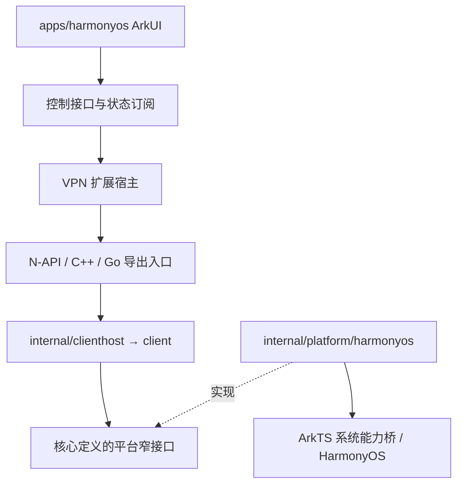

# 项目布局

状态：已确认，鸿蒙先行实施；其他平台待逐端迁移。日期：2026-10-26。

本文定义目标目录与迁移计划，不描述当前全部代码已符合该规范。
鸿蒙已落地 apps/harmonyos 与 internal/platform/harmonyos；其他平台逐端整理，不进行全仓一次性搬迁。
提案实施后，将稳定规则合并到技术架构和开发文档，本文保留决策与迁移依据，
不作为第二套构建操作手册。

## 1. 背景与目标

共享业务在 internal/client、clienthost、server、privileged 中已有清晰职责。
平台应用工程则按不同阶段的技术选择分散在 platform/、ui/、mobile/、ios/ 和 packaging/：
macOS、Windows 原生 UI 在 platform/，Wails 在 ui/，移动端共享 Fyne 与 Android 工程在
mobile/，iOS 工程及 Go 导出入口又分处 ios/ 和 mobile/ioscore。
提案前鸿蒙仅有独立原型；当前正式工程已位于 apps/harmonyos，诊断工程配置仍生成到 .dev。

目标是让平台应用源码、宿主、桥接、资源和工程配置有统一入口，并明确它们与共享业务、
系统适配、自动化及交付配置的边界。新增 apps/ 表达平台应用工程；不以目录名称推断
现有目录的历史设计意图。

## 2. 顶层目录职责

| 目录 | 职责 | 边界 |
| --- | --- | --- |
| cmd/ | Go CLI、daemon 可执行入口 | 命令解析和组装，不承载 UI |
| internal/ | 共享业务、契约、宿主、特权操作及 Go 系统适配 | 不依赖平台 UI 工程或 N-API |
| apps/<platform>/ | 平台应用工程：UI、生命周期、桥接、组装、资源、原生工程配置 | 不复制共享认证、选路、重连状态机 |
| apps/shared/ | 确有多个平台共用的呈现代码，如 Fyne/Wails 前端 | 不成为通用工具或业务逻辑堆放处；鸿蒙阶段不创建 |
| scripts/ | 统一操作入口与分平台自动化实现 | 不隐藏正式应用源码或维护第二份 manifest |
| docs/ | 产品、架构、协议、版本及验证契约 | 平台操作并入现有开发文档 |
| .dev/<platform>/ | 本机配置、缓存、生成物、开发构建和诊断报告 | 忽略提交，可删除后由源码与工具链恢复 |
| dist/<platform>/ | 面向交付的安装包、符号及构建清单 | 忽略提交，与开发中间文件分开 |

platform 名称固定为 macos、windows、linux、android、ios、harmonyos。
iPadOS 属于 ios，不单独复制工程。internal/platform/darwin 等现有 Go 包名不为统一外观强行改名。

### platform 与 packaging 的去向

顶层 platform/ 的原生客户端 UI 在对应平台迁移时移入 apps/<platform>/；
Go 系统实现继续留在 internal/platform/，两者不会合并。

客户端 packaging/<platform>/ 的交付专用配置迁入 apps/<platform>/packaging/。
必须由原生工程识别的 manifest、Info.plist、entitlements、资源及构建描述文件，
保留在原生工程要求的位置，不在 packaging/ 复制一份。

packaging/fnos 保留为服务端交付工程，本提案不强行把无独立客户端 UI 的服务端归入 apps/。
packaging/assets 等共享资源和根目录测试，在明确引用方后另行归属，不在鸿蒙阶段删除。
迁移期间允许旧目录存在，但每项源码或配置只能有一个权威来源。

## 3. 鸿蒙目标结构

```text
apps/harmonyos/
├── toolchains.json                   唯一固定工具链清单
├── AppScope/                         应用元数据与公共资源
├── entry/
│   ├── build-profile.json5
│   ├── oh-package.json5
│   ├── hvigorfile.ts
│   └── src/main/
│       ├── module.json5
│       ├── ets/
│       │   ├── entryability/         UI 应用生命周期
│       │   ├── vpnability/           VPN 扩展生命周期与系统入口
│       │   ├── pages/
│       │   ├── components/
│       │   ├── controller/           命令、状态订阅与展示模型
│       │   └── platform/             ArkTS 系统 API 适配
│       ├── cpp/                      N-API、线程派发与 ABI 桥
│       └── resources/
├── go/                               Go 导出入口及宿主组装
├── diagnostics/                      runtime/VPN 专项验证源码
├── tests/                            平台集成、宿主与 UI 验证
├── packaging/                        分发配置、签名模板、许可清单
├── hvigor/
├── build-profile.json5
├── oh-package.json5
└── hvigorfile.ts

internal/platform/harmonyos/           Go TUN/WireGuard、网络与系统适配
scripts/harmonyos/                     安装、构建、签名、检查实现
.dev/harmonyos/                        本机状态、开发产物与验证报告
dist/harmonyos/                        发布候选产物
```

这是归属规范，不要求一次创建所有空目录。VPN 扩展先留在 entry 模块；是否拆成其他
HAP/HSP 模块由平台约束和部署需求决定，目录设计不预设进程数量或安装包数量。
诊断程序与正式应用分开选择构建目标，不能把测试回显器、测试路由或自动请求公网的行为
带入正式用户流程；诊断权限和测试端点仅在诊断目标声明。

正式原生工程直接纳入版本管理。生成脚本可继续产生桥接头文件、版本资源和中间工程，
但不把整个正式工程的唯一来源隐藏在 Python 字符串中。
若厂商工具必须在工程内写入 build/、.hvigor/、oh_modules/ 等内容，按明确规则忽略，
无须为追求目录外观改写厂商布局。生成的 Go .so/.h 同样忽略，不提交二进制副本。
依赖锁文件按对应构建工具规则提交，保持依赖版本可追溯。

## 4. 依赖与组件关系



- apps/harmonyos/go 可以导入 internal/clienthost、client 和平台适配，负责组装。
- internal 不导入 apps，UI/桥接依赖不能泄漏到共享业务。
- 平台适配通过接口或回调使用宿主能力，不反向导入应用入口。
- N-API 管理 ABI、线程、资源所有权和异步事件，不持有第二套产品状态机。
- 桌面继续保持 client daemon 与 client privileged daemon 的权限隔离。
- 移动端复用同一业务与网络计划边界，不照搬桌面双 daemon 进程；唯一活动 Manager
  由系统生命周期宿主持有。组件通信方式与授权边界不因目录移动而变化。

鸿蒙 go/ 初期使用根 Go module，避免仅为目录组织引入新 module 或不必要依赖。
未来迁移现有 mobile/ui 独立 module 时，先保留模块边界，再单独评估调整；
不将 module 重构、UI 框架替换和目录搬迁混入同一变更。

## 5. 自动化和工具链约定

根目录提供少量固定入口：

| 入口 | 职责 |
| --- | --- |
| scripts/setup-harmonyos-macos.sh | 显式准备固定 CLI/Go，复用公共安装并运行构建探针 |
| scripts/build-harmonyos.sh | 使用已有工具链构建；不隐式安装工具或接受许可 |
| scripts/check-harmonyos.sh | 静态检查、单元测试、包内容检查；设备检查显式选择目标 |
| scripts/package-harmonyos.sh | 使用显式签名配置生成可交付产物和清单 |

诊断构建作为明确目标或参数接入，不持续增加同义顶层入口。具体参数在实施时确定。
尚未实现的入口在文档中标记为计划，不写成可直接执行的现有命令。

工具链仅在 apps/harmonyos/toolchains.json 维护，脚本读取该清单；
公共依赖目录沿用 ~/.local/opt/harmonyos/ 与 ~/.cache/harmonyos/，不含项目名称，
不覆盖默认主机 Go，不全局设置交叉编译变量。
证书、私钥、profile、密码及 token 放在仓库外，通过显式参数或环境注入；
项目内只提交无敏感信息的模板。

## 6. 现状到目标映射

| 当前 | 目标或处理 |
| --- | --- |
| harmonyos/smoke/ | apps/harmonyos/diagnostics/；正式可复用桥接再提取到 entry/cpp、go |
| .dev/harmonyos/hap-smoke 生成工程 | 诊断生成物可保留；正式工程提交到 apps/harmonyos |
| apps/harmonyos/toolchains.json | apps/harmonyos/toolchains.json，同步全部读取方 |
| scripts/harmonyos/*.py | 保留自动化实现，消除硬编码旧源码路径 |
| docs/development.md 等现有主题文档 | 环境、构建、架构与验收按现有主题维护，不新增平台文档层次 |
| platform/macos、platform/windows | 后续分别移入 apps/macos、apps/windows |
| ios、mobile/ioscore | 后续原生工程及导出入口移入 apps/ios，保留原 module 约束 |
| mobile/android | 后续移入 apps/android |
| mobile 根目录共享 Fyne UI | 后续归 apps/shared 下的独立共享 UI 工程，不复制到每个平台 |
| mobile/internal/*vpn | 后续审查平台适配边界后归 internal/platform/<平台> |
| ui/ Wails 工程 | 后续拆清共享呈现与平台宿主，再迁入 apps/shared 及对应平台；不先机械搬迁 |
| packaging/ 客户端配置 | 对应 apps/<平台>/packaging 或厂商工程要求的位置 |
| packaging/fnos、nix、Casks、website | 本阶段保持原状；不属于新增鸿蒙 UI 的必要迁移 |

## 7. 演进计划与验收门槛

### P0：明确规范（本次）

交付提案与索引，不搬迁源码、不改变构建和运行行为。
目标目录尚未落地，不能据本文宣布其他平台已完成整理。

### P1：鸿蒙目录落地

1. 迁入诊断源码及工具链清单，修改脚本读取路径与资源引用。
2. 建立纳入版本管理的正式原生工程，保留独立诊断构建目标。
3. 将 Go 导出组装和平台适配按依赖边界分开，明确 fd、线程与宿主所有权。
4. 更新 .gitignore、构建入口和平台 README；旧文档提供短期链接。

验收：新 worktree 可按文档准备环境并构建；脚本/Go 测试和 HAP 内容检查通过；
已有 runtime/HTTPS/WSS 模拟器验证可重复；诊断路由不进入正式目标。
VPN 授权组件缺失导致的验证阻塞继续如实记录，不因搬迁变更为通过。

### P2：鸿蒙完整功能开发

在新目录完成共享 clienthost 接入、UI、授权、三种连接路径、DNS、存储、生命周期、
管理后台及诊断。构建、签名和打包入口依职责收敛，单一来源生成产品版本。
依用户安排，优先完成代码和可自动执行检查，再集中云真机验证。

验收：形成可签名候选产物及功能/验证矩阵，每项区分代码完成、自动化通过、设备待验。
不能用工具链探针替代产品运行结果；设备验证发现的问题继续修复。

### P3：鸿蒙集中设备验证和交付

使用具备 VPN 系统能力的云真机或实体设备，验证系统授权、TUN/protect、真实服务端
连接、LOCAL/DIRECT/RELAY、DNS、切网后台、撤销、清理、签名升级与数据保留。
记录产品版本、commit、包 hash、设备/系统信息和结果，完成必要兼容性验收后再发布。

### P4：其他平台逐端迁移（后续任务）

建议先整理边界清晰的 Windows 原生 UI 与 macOS 默认原生 UI，再处理 iOS/Android
共享 Fyne 工程，最后收敛 Wails/Linux 及剩余共享交付配置。
具体顺序以届时开发与发布安排为准，不是本次授权的搬迁范围。

每个平台独立完成：引用清点 → 机械搬迁 → 更新脚本/CI/版本同步/资源路径 →
原构建和安装升级检查 → 更新文档 → 删除失效旧入口。
共享 UI 拆分与平台能力修改单独提交，避免将行为差异混入搬迁验证。

## 8. 兼容性、发布与回退

遵守[版本与兼容性](versioning-and-compatibility.md)。纯源码重排不要求提升 MAJOR；
不改变远程准入规则、IPC 语义、持久化 schema 或运行时数据路径。
尤其保留 bundle ID、服务名、IPC 端点、Keychain/Keystore 命名空间、安装目录、
升级身份和签名关联，除非另有明确的功能变更设计与迁移验证。

每端迁移需检查 scripts/sync-version.py、发布资产清单、许可证、CI、安装/卸载测试及
文档引用。命令兼容性通过根目录入口维持；必须改变旧入口时短期提供转发或明确错误，
不维护两套实现。新构建来自干净 checkout，不能依赖旧目录残留。

未发布源码可通过 Git 回退目录迁移；已安装程序的降级仍按配套备份与版本契约处理。
源码回退不等于自动回退用户数据。公开发布产物不得因目录迁移重新覆盖。

## 9. 本提案的完成定义

鸿蒙符合上述源码归属、依赖边界、构建入口与生成物规则，并有可重复验证证据后，
才能称鸿蒙目录规范落地。其他端整理完成前，仓库允许处于明确记录的过渡状态。
